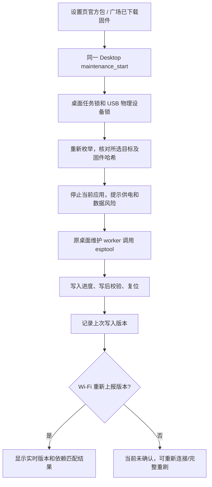
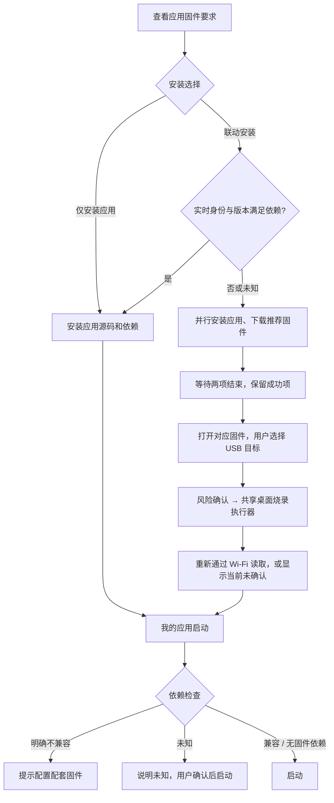

# 应用与固件广场实施方案（2026-10-30 修订）

本文是当前功能分支的实现与交付边界，替代先前关于 schema 4、application-list-v2.json、SDK 执行烧录的设计。应用、固件独立发布；可通过依赖关联。桌面端负责 USB 烧录，SDK 负责分发和协议元数据。自动化验证不等于真实硬件验收；代码交付与平台状态见末节。

## 用户看到什么

```text
应用广场
├── 应用与固件
│   ├── 应用：应用卡片 → 详情 → 安装
│   └── 固件：固件版本 → 下载 → 选择 USB 设备 → 确认并烧录
├── 我的应用：已安装应用、启动/停止、卸载
└── 上传
    ├── 应用：保留原发布向导
    └── 固件：登录平台 → 选固件 ZIP → 上传 → 提交审核
```

卡片、按钮、筛选、提示、详情面板沿用现有组件样式与设计变量。固件列表直接显示搜索与卡片；同 ID 多版本聚合为一张卡，点击后才展示版本、下载、设备状态与 USB 烧录。应用和固件不混成一个条目；也不增加独立的“固件与设备配置”顶层页。与参考广场保持搜索、版本、作者和详情的基本组织；额外流程只服务真实设备写入与配套依赖。

三种用法：

| 开发内容 | 发布内容 | 体验者操作 |
| --- | --- | --- |
| 只有应用 | 应用源码、已有 app.json | 安装到电脑，再启动 |
| 只有固件 | 编译好的固件包、版本元数据 | 下载后通过桌面 USB 烧录 |
| 应用＋配套固件 | 两份独立资源；应用引用固件 ID、兼容范围和推荐版本 | 可仅安装应用；或联动下载安装，再选择设备确认烧录 |

应用详情显示配套信息、“查看配套固件”“仅安装应用”“安装应用并烧录配套固件”。联动入口可以减少重复找版本、下载的步骤，写入硬件前仍需确认 USB 目标和数据风险。已通过实时身份和版本匹配确认兼容时可跳过烧录；版本未知时不会自动宣称兼容。

## 各仓库修改清单

| 仓库/平台 | 修改 | 不承担的职责 |
| --- | --- | --- |
| Python SDK | 可选固件依赖解析；HF/Gitee 固件发布、审核提交、目录读取、下载校验与缓存；Wi-Fi 元数据桥接及状态判定 | 不新增 USB 枚举、烧录命令或 esptool 执行器 |
| 桌面端 | 三入口与两分类；独立固件上传；应用配套联动；共享 Daemon socket 版本显示；复用设置的维护 worker | 不复制 Daemon，不另建设备业务连接 |
| HF 官方目录 Dataset | 原 app-list.json 继续收录全部应用；新增 firmware-list.json | 不建立按桌面版本分裂的应用目录 |
| Gitee 官方目录仓库 | 与 HF 相同的逻辑目录；固件条目绑定 Release 附件和哈希 | 不通过可变 tag 代替完整性校验 |
| 作者应用仓库 | 可选 requires_firmware；原源码发布方式保留 | 不复制固件 ZIP 到应用仓库 |
| 作者固件仓库 | 按版本保存烧录产物与发布元数据 | 桌面不下载源码临时编译 |
| ESP32 / STM32 / Server | 本次不修改 | 不新增 OTA、MCU 协议或 STM32 烧录 |

## Hugging Face / Gitee 目录结构

国外目录：HF Dataset `Orulink/watcherobot-app-store`。国内目录：Gitee `orulink-sz/watcherobot-app-store`。

```text
watcherobot-app-store/
├── app-list.json          # 全部应用；HF space_id / Gitee repo_id + 固定 commit
└── firmware-list.json     # 固件及其版本；独立 JSON 合同
```

```text
Hugging Face
  Space 作者/WatcherRobot-应用ID                 # 应用源码，原流程
  Dataset 作者/WatcherRobot-Firmware-固件ID
    versions/1.0.0/firmware.zip                  # 编译好的烧录包
    versions/1.0.0/release.json                  # SDK 生成的发布元数据

Gitee
  作者/WatcherRobot-应用ID                       # 应用源码，原流程
  作者/WatcherRobot-Firmware-固件ID
    versions/1.0.0/manifest.json                 # Git 中的发布元数据
    Release v1.0.0 @ 固定 commit
      firmware.zip                              # Release 附件
```

固件 ID 在平台内唯一；一个固件仓库包含多个版本。同版本内容不可覆盖，失败重试检查已有元数据与附件；内容不同需递增版本。HF 用固定 commit 下载；Gitee 目录同时绑定 commit、asset_id、下载 URL、大小和 SHA-256。附件发生替换则校验失败，不按 tag 名盲信。

固件目录顶层为 `{"schema_version":1,"firmwares":[]}`。每个版本含 ID、版本、仓库、完整 commit、包大小、SHA-256、撤回状态与平台定位字段；可包含名称、作者、更新说明、SKU、硬件版本。`publisher_kind` 默认 community；`ota_supported` 默认 false。官方标识由审核目录控制，不信任作者自行声明。

不在本次开发中空覆盖线上目录。维护者先审核新增 firmware-list.json，再收录官方或作者固件，最后收录引用它的应用。应用和固件均使用当前地区平台，引用未在同来源收录的固件会阻止提交；不会悄悄跨境切源。

## 应用依赖与兼容

保留 app.json 原 schema 2/3 与 SDK 精确依赖锁；可选添加：

```json
{
  "requires_firmware": {
    "mode": "required",
    "firmware_id": "com.example.custom",
    "version_spec": ">=1.0.0,<2.0.0",
    "recommended_version": "1.0.0",
    "tested_versions": ["1.0.0"]
  }
}
```

纯软件应用可显式使用 `{"mode":"not_required"}`。旧应用未填此字段时保留原始数据、继续展示/安装，状态为“未声明”，不自动填充当前固件、不猜测兼容性。无需为缺少新字段的旧条目迁移文件或编造参数。已填写但内容错误的依赖必须报错，不能忽略后按普通应用安装。

兼容目标是新客户端读取现有应用数据，不保证旧桌面端支持新固件能力，也不为旧桌面端另建目录。依赖配置操作先预览，再以原文件哈希确认保存，保留原 schema 和其他字段。SDK 配置请求按规范化清单路径加跨进程锁，在锁内读取、校验和保存；临时文件写好后再次核对原文件。外部编辑器不参与此锁，最终复检和替换仍不是面向任意外部写入者的严格条件更新。字段缺失保持未声明；显式 null、空对象或其他非法类型均拒绝。

使用官方固件的应用同样声明官方固件 ID、兼容范围、推荐版本、已测试版本。上传时读取开发者项目的声明；不会把上传者此刻连着的机器人版本直接写成应用要求。官方 0.5.7 尚需以真实编译产物和正式 ID 审核收录后才能供依赖选择，不能虚构目录条目。

## 发布与下载流程


上传期间持续显示工作阶段和不定进度指示，有精确字节计数时才显示百分比。不能用虚构进度代替平台响应。失败保留重试入口；同版本发布可检查已有资源后重试。提交重试只比较固定产物引用、大小和摘要，不以维护者修改的展示/官方策略字段判断为不同产物，也不覆盖这些审核字段；已撤回版本要求维护者重新审核。

下载使用有界流式读取、哈希校验和原子缓存，失败重新下载；当前不宣称 HTTP 断点续传。未声明或明确不需要固件的应用先返回无需配套，不依赖固件目录。实际下载/缓存复用前重新读取当前目录，已知撤回立即拦截；目录无法获取时只可复用完整校验通过的已有缓存，返回 catalog_stale 和警告，不使用旧目录发起新包下载。桌面展示离线状态，并在 USB 最终确认中提示当前撤回状态未确认。目录持久化失败不会静默降级为旧审核结果。

烧录包根目录包含 firmware.json、flash_args.txt 及其声明的二进制分段。firmware.json 定义 schema、ID、版本、ESP32-S3 芯片、SKU、硬件修订、闪存容量、分段路径/偏移/大小/哈希及可选说明。分段起始偏移必须按 4096 字节擦除扇区对齐，向上取整后的擦除范围不得重叠，分段长度可以不对齐。路径穿越、符号链接、重复项、重叠、超限、未声明条目或危险烧录参数均拒绝；不运行包中脚本。

当前信任依据是维护者审核的目录、固定来源与 SHA-256 完整性校验；这不等同于开发者公钥签名或硬件 Secure Boot 验证。独立签名信任链尚未实现，不应在界面上声称“签名已验证”。

## 设置与广场共用的 USB 流程



实际 UI 在确认后先停止应用，再向共享 worker 下发；worker 取得物理锁后复制有界私有快照，重新核验包和 USB 身份，并只烧录已验证的同一快照，避免缓存文件在确认后被替换。设置页旧包解析及官方 READY 检查保留；广场包支持声明的自定义分段文件名，不要求第三方实现官方 READY。芯片固定为当前支持的 ESP32-S3。

无设备时可下载，但必须明确提示连接数据 USB、刷新、选择端口，禁止直接写入。当前端口枚举沿用项目 WatcheRobot 通道识别，不扩展任意芯片烧录器。SKU/硬件版本可展示核对，无法读取硬件身份时由用户确认；不把未知当匹配。自动下载模式失败时提示 BOOT/RESET。

设置与广场不各维护一套烧录算法。两者共用任务、设备锁和退出保护；同一物理设备即使出现两个 USB 接口也不能并发。任务查询短暂失败继续恢复进度，不把仍可能写入的任务误报为完成。记录原子保存，历史写入不等于运行成功。

断电、拔线或进程被强杀后按完整包重刷恢复，不做任意偏移续写。设备要支持 A/B、引导回退才可能安全自动回滚；本次不承诺该能力。用户可选择已收录的旧版包重新烧录，但这是完整重刷，不是失败后的自动回滚。

## 配套安装流程



应用安装不暗中触发硬件写入；联动时仍有设备选择和最终风险确认，不自动启动应用。一个资源失败不撤销另一个已经成功的资源，后续可复用已校验的缓存。

## Wi-Fi 版本与 OTA 边界

官方 0.5.7 已通过 WebSocket `evt.sdk.ready.data.firmware_version` 上报 ESP 应用描述中的版本。桌面通过现有唯一共享 Daemon 业务 socket 请求 `sys.sdk.ready.get` 并接收返回；SDK Application transport 通过自身 Device/Desktop channel 转接这项元数据协议。无 Application 时仍由 Daemon 透明转发。Daemon 不根据业务 type 添加旁路，麦克风等帧仍遵循原路由。

| 证据 | 页面含义 | 可自动判定配套兼容 |
| --- | --- | --- |
| 新鲜 Wi-Fi 上报版本和固件 ID | 当前版本 | ID 与范围均满足时可以 |
| Wi-Fi 只上报版本 | 当前版本已读取，身份未知 | 不可以仅凭版本推定官方/兼容 |
| 桌面成功写入记录 | 上次烧录版本，当前未确认 | 不可以 |
| 未连接、不上报或过期 | 当前版本未知 | 不可以 |

查询沿当前所选设备进行，切设备、断线和烧录后清空旧观察。元数据有 30 秒新鲜度限制；版本前缀 v 按三段数字版本规范比较。历史记录只按用户确认关联的机器人键显示，不宣称 USB 与 Wi-Fi 身份已经自动证明一致。

第三方固件不上报时仍可烧录，页面保留上次写入信息。若希望在 Wi-Fi 下显示当前版本，第三方固件需实现对应版本上报；SDK 无法读取任意自定义固件内部版本。当前官方 0.5.7 未提供可验证的固件 ID，不能凭 0.5.7 字符串自动认定官方。

第三方固件只提供 USB 更新。官方 OTA 保留设备现有功能，资格提示要求官方命名空间、审核元数据和实时身份匹配；本次没有新增桌面 ESP32 OTA 执行 API。桌面应用自身更新器与设备固件 OTA 无关。本次不修改 ESP32 来补身份协议。

## 验证与交付

自动化覆盖双平台模拟发布/下载、异常包、依赖配置确认、历史与实时证据区别、应用通道路由、共享桌面写入、错误重试、设备变化和并发拦截。USB 测试使用模拟进程，不写真实设备。正式平台和 Windows/macOS 驱动仍需实机验收。

正式上线顺序：完成代码审查 → 用户允许后分别提交 SDK/桌面 → 更新真实 SDK 来源锁并构建 → 双平台维护者收录目录和官方固件 → 真实账号匿名下载及 USB 验收 → 发布桌面版本。2026-10-30 最新授权允许分别提交并推送 SDK、桌面端功能分支，提交信息中英文说明；不创建 PR、不上传实际固件、不改 meta repo gitlink。桌面来源锁指向已经推送、可获取的配套 SDK 完整提交。

剩余联调预计：真实 HF/Gitee 账号与权限、官方固件包齐备时约 1–2 个工作日；Windows/macOS 实机、断线恢复、打包回归约 1–2 个工作日，可部分并行。若需要签名信任链、自动回滚或补官方固件身份协议，应另估范围，不把它们算作本次已完成。

## 2026-10-30 平台目录同步状态

- Gitee：README 与 firmware-list.json 已更新，原 5 条应用记录逐字节校验未改；当前尚未收录真实固件。目录提交：[3af3d73](https://gitee.com/orulink-sz/watcherobot-app-store/commit/3af3d7312e12684242da917f8f1381559a4a6c74)。
- HF：已有凭据不能直接修改组织主分支，已提交[结构更新 PR #56](https://huggingface.co/datasets/Orulink/watcherobot-app-store/discussions/56)，待维护者合入；原 9 条应用保留。不能将待合入 PR 说成线上目录已生效。
- 没有伪造官方 0.5.7 产物或创建示例固件条目。

## 2026-10-30 全链路复核

- Gitee 首次固件发布同时处理 Contents API 的 `404` 与 `200 + []` 缺失文件响应；已存在的元数据和附件仍禁止以不同内容覆盖。
- 双平台组合测试覆盖应用安装、已安装依赖读取、固件推荐版解析、匿名下载失败、保留应用、重试和校验缓存复用；环境安装及平台写入使用替身。
- 真实匿名读取：HF 主目录 9 个应用，Gitee 5 个应用；分别实际下载一个固定提交的应用源码并完成校验，没有运行其代码或安装依赖。
- HF 主目录尚无 firmware-list.json；Gitee 固件目录正常返回空列表。因此真实固件上传、收录后的匿名下载和 USB 实机写入仍待真实发布产物验收，不能用模拟通过替代。
- 桌面复核修复联动准备失败后的过早跳转、切换应用的旧固件选择和缺少 USB 序列号时的物理设备互斥；继续共用原设置维护执行器。
