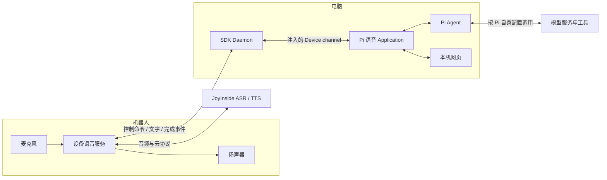
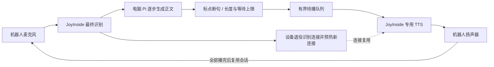

# JoyInside 本地 Pi 语音 Application

## 0.1.1 更新

- Pi 可见正文逐步显示，并按标点分句依次播报；暂停会取消当前操作并清空待播队列。
- 正常轮次复用 SDK 语音会话，开始时提前启动 Pi；配套固件支持成功 TTS 后复用云连接，减少分句与再次开麦的等待。
- 补充启动错误、资源释放和 Pi 超时处理，显示真实的聆听、生成、播报及暂停状态。

使用前需安装并登录配置 Pi，并准备声明 `speech.joyinside.v1`、已配置 JoyInside 的机器人固件。应用下载不包含固件更新；设备端的连接复用和识别修复需要配套新版固件。当前采用半双工，播报期间不采集麦克风，也不支持语音打断。

机器人采集麦克风、连接 JoyInside、返回最终 ASR 并播放指定文本的 TTS；电脑 Application 把文字交给本地 Pi。密钥保留在设备上，Daemon 仅转发业务帧。

使用包含 `robot.speech` 的 SDK 源码版本和声明 `speech.joyinside.v1` 的固件。机器人需配置 JoyInside，并与电脑处于同一局域网。按 SDK README 完成配对，安装 Pi 并配置其模型与登录，再从 SDK 仓库根目录执行：

```text
watcherobot app run examples/joyinside_pi
```

也可以传入 Application 绝对路径。启动后自动打开本机网页，默认待机不开麦。点击一次“开始对话”后自动进行连续多轮，点击“暂停对话”取消当前操作并释放音频；Pi 进程跨轮保留上下文。桌面 `ctrl.microphone.close` 暂停、`ctrl.microphone.open` 恢复；未支持的桌面业务消息安全忽略。不要直接运行 `python app.py`。

Pi 默认从 PATH 查找，Windows 自动解析 npm 启动器为 Node + CLI。`PI_COMMAND_JSON` 可指定完整 JSON argv 数组，例如 `["node","/path/to/pi/cli.js","--mode","rpc","--no-session"]`。`PI_WORKDIR` 指定 Pi 工作目录。不通过 shell 拼接语音，Pi 使用自己的模型、权限和工具设置。

测试环境变量：`WATCHER_SPEECH_AGENT=echo` 复述识别结果；`WATCHER_SPEECH_ONCE=1` 完成一轮后暂停；`WATCHER_SPEECH_TEST_TEXT` 设置短文本时自动测 TTS 并暂停。`WATCHER_SPEECH_AUTOSTART=1` 自动开始监听；`WATCHER_SPEECH_NO_BROWSER=1` 禁止自动打开浏览器。不要将本机配置写入 manifest。

- 模式是 `conversation_asr`，云端仍可能运行 Agent，固件丢弃其自动音频。指定文本使用专门的 `CLIENT_INPUT_TEXT_TO_SPEECH`，不提交给云端 Agent。
- 会话独占音频并采用半双工，识别结束后关闭麦克风，Pi 处理与播报期间不录音，暂不支持语音打断。
- 单次 TTS 1–999 UTF-8 字节；示例按标点增量断句，每段最长 96 个字符。正常轮次复用语音会话，每 32 个请求在上一操作完成后自动换会话，暂停、错误和退出时释放。
- 播报 Pi 可见 assistant 正文，包括工具调用前的说明；不播报思考、工具参数或工具结果。需 Pi 1.1 的 `agent_settled` 决定整轮成功。正文改写、交互式扩展请求、超时和供应商失败会停止并提示；已经播出的内容无法撤回。

详见 [设备语音接口](../../docs/device-speech.md)。

## 测试与断句说明

测试环境变量必须在启动 Daemon 的环境中设置，Application 继承 Daemon 的环境；只在调用 CLI 的终端设置，不能改变已经运行的 Daemon。改变配置后重启相应 Daemon，避免停止其他项目正在使用的实例。

麦克风头部黄灯亮起后说话。当前使用 JoyInside 云端 VAD；最终 ASR 返回后立即关麦并运行 Pi。房间内其他声音也可能先被识别；没有端侧静音门限、唤醒词或播放中打断。识别等待默认 30 秒，超时会清理并重试。

### 流式播报与连接复用

Pi RPC 的 `text_delta` 逐步显示到页面，并送入断句器。句号、问号等立即形成一句；逗号等软断点至少积累 12 个字符；无标点积累至 96 字或等待 700ms 且已有至少 12 字时也会发送，结束时发送尾句。英文句点等待后续空白，避免误切小数或域名。回复上限 16000 字符。

点击开始时先启动 Pi 进程，让其初始化与设备建连、用户说话重叠；正常轮次和待机复用该进程及上下文。

Pi 是电脑上的 Agent，模型请求按 Pi 自身的 provider 配置执行；模型是否在本机取决于该配置。

最多缓存 8 个增量和 2 个待播分句，单个播放任务按顺序等待每句 drain，慢速播报会向 Pi 读取施加背压。暂停会取消 Pi、停止当前播报并丢弃队列；部分回复标记“已中断”。Pi 的 120 秒等待预算包含背压等待，过长回复可能达到此预算。

配套固件在成功专用 TTS 后保留云连接，供下一句或下一次 ASR 使用；ASR、取消或失败后退役连接。ASR 后可在同一工作任务中预先建立下一条连接，与 Pi 生成重叠，始终只保留一条云连接。保留旧轮次过滤，历史容量将满时重建。旧固件仍可运行示例，但无法获得设备端连接复用的收益。



以下是逻辑流水线，其中应用与设备之间的业务消息都经过 Daemon：



`/api/state` 的 `timings` 和应用日志记录 ASR 完成后的首段正文、首个 TTS 请求、Pi 完成、播报完成，以及播报后下次聆听请求的毫秒数。首个 TTS 请求时间不等于首声；设备串口的 `First PCM submitted` 与 `Microphone ready` 分别记录首段 PCM 提交和麦克风启动。

2026-10-14 已在 ESP32 PTL / Debug CLI 固件上完成中文真实麦克风 → 本机 Pi → 专用 TTS 验证，以及长文本播报、取消、超时、音频互斥和会话重开。没有执行长期稳定性或识别准确率统计；内存与主任务栈余量仍需持续观测。

2026-10-16 配套新版固件与流式示例完成三轮真实人声连续对话，用户确认能听到回复。设备日志测得前两次播报完成至麦克风就绪为 202ms、289ms，此前样本约 2.2 秒；此结果仅代表开麦间隔。前两轮 Pi 首段分别等待约 2.4 秒、12 秒（后者含工具查询）；第三轮较长工具查询首段约 66 秒、Pi 完成约 91.5 秒，首个 TTS 请求早于整轮完成约 25 秒。分句播报不能消除首段生成或工具执行的等待。没有进行声学首声或长期稳定性统计。

## 连续对话网页

Application 日志打印本机网页 URL，端口自动分配。网页显示真实设备连接、聆听/思考/播报/清理状态、最终识别文字、Pi 回复与完成轮数。连续模式为半双工：回复 drain 后自动重开下一轮，不需要重复点击开始。无声等待超时会重新聆听。Pi 进程在正常轮次与暂停之间保留上下文；取消正在进行的 Pi 请求、故障或退出会退役该进程，后续重新建立上下文。

页面刷新不会停止正在进行的对话，暂停或结束 Application 才关闭会话；聊天记录保留于当前 Application 内存中，最多 80 条，服务重启后清空。HTTP 仅监听 127.0.0.1，并检查 Host/Origin。页面控制由 Application 自身执行，使用注入的 Device channel；不通过管理接口绕过 Application，也不建立第二条设备连接。

关闭 Application 使用 SDK/桌面端的停止操作。开发者可以不配置真实设备直接运行 `python -m pytest tests/test_pi_speech_web.py` 验证多轮与暂停的行为合同。

网页显示“机器人已连接”仅代表设备控制连接可用，不代表 JoyInside 语音会话已成功启动。语音会话启动、Pi 回复或播报超时时会停止自动轮次并保留错误提示；只有聆听期间的无声等待超时会自动重新聆听。资源释放失败时也会保留提示，排除设备连接、固件或云端配置问题后再点击开始。

多台机器人同时在线时，先核对页面设备 ID 与目标机器人一致。Daemon 可能仍保留另一台机器人的连接；`robot pair` 在已有设备连接时不会自动切换目标。切换前停止当前 Application，在桌面设备管理中断开旧设备，再用目标机器人当前配对码重新配对。USB 插入某台机器人不会自动切换 Daemon 的网络连接。
